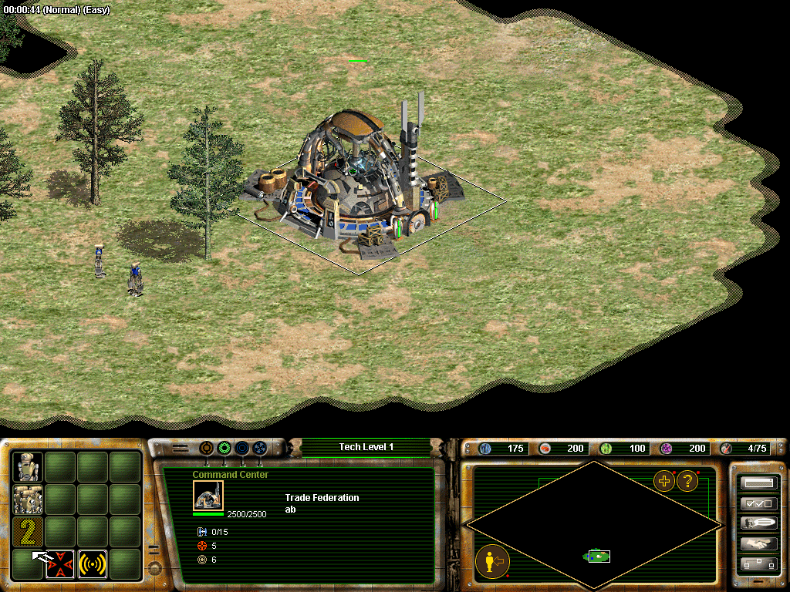
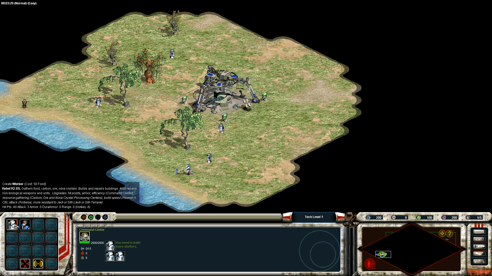
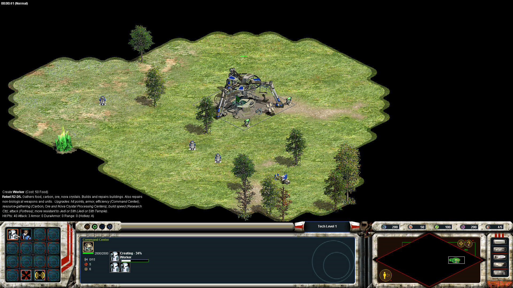
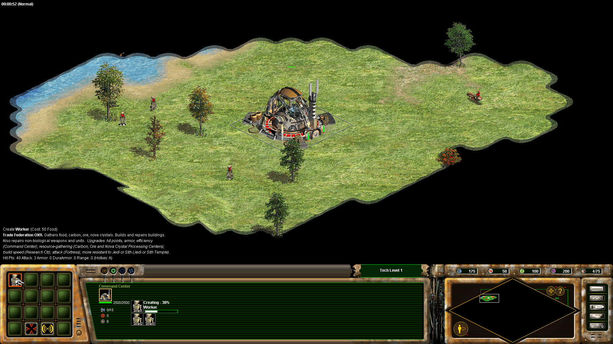

# Star Wars: Galactic Battlegrounds — Static Recompilation

Static recompilation of **Star Wars: Galactic Battlegrounds** (LucasArts and
Ensemble Studios, 2001; the Age of Empires II Genie engine) from its shipping
Win32 executable, `Battlegrounds.exe` v1.1, to native C that runs on modern
Windows. No emulator: the game's own code, recompiled, with a software
DirectDraw so the desktop's display mode never changes.

Built on the [pcrecomp](https://github.com/sp00nznet/pcrecomp) toolchain, on
its `main` branch, and following
its house style: layout, command line, conformance harness, headless mode.

## What the remaster adds

- **High resolution and widescreen**: the game's own 1024x768 and 1280x1024,
  which crashed, and any size from 1024x720 up, 16:9 and 21:9 included. A
  bigger size shows more of the battlefield, not a bigger picture: the
  interface is the game's own layout for the nearest of its sizes, moved to
  the edges, with its panel art widened to fit
  ([hires.md](docs/hires.md)).
- **LAN multiplayer**: games found and played between machines on the LAN,
  on pcrecomp's own DirectPlay over TCP, with nothing to install
  ([multiplayer.md](docs/multiplayer.md)).
- **Options**: `swgbrecomp.ini` beside the program, or the command line:
  the resolution (`--res 1920x1080`, or `--res screen` for the screen's own),
  where else to look for LAN games (`--lan-host`). An F10 menu for them
  comes with pcrecomp's shared presenter ([ROADMAP.md](ROADMAP.md)).

`--classic` gives the original game: 800x600, the size the game shipped with.

## Getting Started

You need **your own copy**: the US release on two discs (disc 1 installs,
disc 2 is the play disc), and LucasArts' v1.1 update `BGUpdate1_1.exe` if
your install is v1.0. Nothing from the game is in this repository or
downloaded for you; everything is built on your machine from your copy.
The CD check passes with disc 2 in the drive or your disc 2 image mounted.

### The setup scripts

1. Install the game from disc 1 the usual way (or copy an installed `Game`
   folder from another PC).
2. Download this repository (the green **Code** button, then **Download
   ZIP**) and unzip it somewhere with 8 GB free.
3. Windows: double-click **`Setup.cmd`**. Linux and macOS are not supported
   yet; `./setup.sh` says so and stops.
4. Play with **`Galactic Battlegrounds`** in that folder.

The script checks for Python 3.10+, `capstone`, the pcrecomp toolkit (cloned
beside this folder if it is missing) and
Visual Studio 2022's C++ tools, and asks before installing any of them. It
asks where the installed `Game` folder, disc 2 (a drive, `.iso` or `.cue`) and `BGUpdate1_1.exe` are (it
looks first; `-GameDir`, `-PlayDisc`, `-PatchExe` and `-Yes` skip the
questions), then catalogs, lifts and builds. The build is 4M lines of C and
takes 30 minutes or more. A rerun skips finished steps, and the details go to
`setup.log`. Building by hand and the command line are in
**[docs/building.md](docs/building.md)**.

## Status

**v0.1.0-dev, alpha.** In game: a Standard Game (random-map skirmish) starts
and plays at 800x600, the game's own 1024x768 and 1280x1024, and the
remaster's sizes up to 4K, alone or over the LAN between two machines;
recompiled throughout, driven headless by scripted mouse and keys. Not yet
played to a finish.

| Stage | State |
|---|---|
| The build | `Battlegrounds.exe` **v1.1** (LucasArts' `BGUpdate1_1.exe` over the US CD), PE stamp `0x3C03FD69` (2001-11-28), MSVC6 C++, DirectDraw 8-bit, DirectPlay, no relocations, no copy protection. Other builds are refused by `run_lift.py` |
| Function catalog (`disasm32`, pcrecomp) | 14,272 functions, 95.6% of the code range, plus 44 seeds in `run_lift.py` (the `THIS_COD` blitter's jump tables) |
| Lift (`run_lift.py --all`) | 14,299 functions, 0 lift errors, 4.0M lines of C; a fix and the remaster's hooks are patches over it, never edits to the C |
| Exception handling | 702 C++ frames (488 of the 489 with a frame are frame-pointer-omitted) and 14 `__try` frames in the CRT, lifted with landing pads by pcrecomp's MSVC EH support ([docs/exceptions.md](docs/exceptions.md)) |
| Host (`swgbrecomp.exe`, 32-bit, pcrecomp `native32`) | 258 imports: 228 go to the real Windows DLLs, 30 are shimmed. DirectDraw is a software one (`softdd`) |
| Game data | `genie.dat` and the `.drs` archives load; the game's deflate decoder is the host's ([docs/lifting.md](docs/lifting.md)) |
| Main menu | **runs**: drawn, mouse hover highlights and help text, Exit works |
| Single Player / skirmish | **runs**: New Player dialog (a name typed into its edit control), Single Player, Standard Game, Start Game, and the map: buildings, units, selection, training, scrolling, the minimap |
| Resolution | **800x600, 1024x768, 1280x1024** (the game's own; the last two crashed) and **any size from 1024x720 up**, widescreen included, with more of the map on screen ([docs/hires.md](docs/hires.md)) |
| LAN multiplayer | **runs**: two machines find, join and play the same skirmish on pcrecomp's DirectPlay over TCP ([docs/multiplayer.md](docs/multiplayer.md)) |
| Campaign | not tried yet |
| Sound | DirectSound and the mixer are the real ones; test runs are muted |
| Headless mode | `--headless --record out.mp4`: a private desktop (pcrecomp `native32_headless`), nothing on the user's screens, frames piped to ffmpeg; muted. Run it in a logged-on session ([docs/testing.md](docs/testing.md)) |
| Conformance harness | **5/5** milestones: boot, `genie.dat` inflated, 800x600x8 with 100 frames, the main menu, the Exit button ([docs/testing.md](docs/testing.md)) |
| Setup.cmd | tested from a fresh clone (2026-11-12): catalog, lift, the full build and the shortcut; the conformance harness 5/5 on that build |
| Linux, macOS | not yet (`setup.sh` says so) |

## Screenshots

Real output of `swgbrecomp.exe --run --headless`, recompiled code throughout:

| | |
|---|---|
|  |  |

The game's own 1024x768, and 1920x1080 (`--res 1920x1080`): more of the
battlefield, the interface at the edges.

| | |
|---|---|
|  |  |

One LAN game at 1920x1080, from the host and from the joiner, on two
machines:

| | |
|---|---|
|  |  |

## Documentation

- [docs/building.md](docs/building.md): building by hand, the v1.1 update, the command line, build options
- [docs/hires.md](docs/hires.md): the game's own sizes, and any size: the class layout, the panels, the widened panel art
- [docs/multiplayer.md](docs/multiplayer.md): LAN games on pcrecomp's DirectPlay
- [docs/testing.md](docs/testing.md): the conformance harness, the scripted skirmish, other sizes and the LAN
- [docs/lifting.md](docs/lifting.md): lifting `Battlegrounds.exe`, every wall so far and its fix
- [docs/exceptions.md](docs/exceptions.md): the game's C++ and SEH exception frames in the lift
- [ROADMAP.md](ROADMAP.md), [CHANGELOG.md](CHANGELOG.md), [CONTRIBUTING.md](CONTRIBUTING.md)

## Contributors

See **[CONTRIBUTORS.md](CONTRIBUTORS.md)** for who did what. Thank you, all of
you.

## License

MIT for this repository's own code ([LICENSE](LICENSE)); miniz is MIT
([NOTICE.md](NOTICE.md)). Star Wars: Galactic Battlegrounds is © LucasArts
and Lucasfilm Ltd.; none of its files, and nothing generated from them, is in
this repository.
